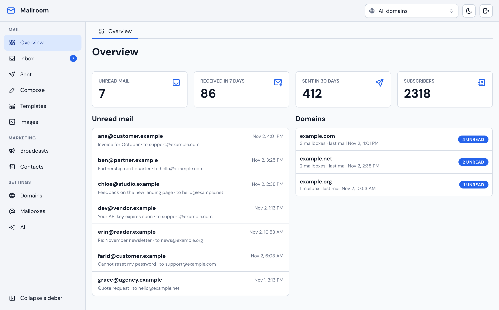

# Mailroom（中文说明）

部署在你自己 Cloudflare 账号上的邮件中心。一次部署可以管理任意多个域名，每个域名有自己的邮箱地址、收件箱、联系人、群发、API key 和 webhook。完整英文文档见 [README.md](README.md)。



## 能做什么

- **收信**：经 Cloudflare Email Routing 收到的邮件存进 D1（附件进 R2），后台可读、回复、归档、搜索
- **发信**：用任意邮箱地址撰写和回复，经 Cloudflare Email Sending 发出，显示投递状态
- **签名和文件**：签名可按域名或共享，每个邮箱地址可设默认签名；文件库存放在 R2，任意大小的文件都能发：放得进邮件的作为附件，超出的作为下载链接
- **群发**：按域名分开的联系人和分组，定时分批发送，每封带独立退订链接（含一键退订），硬退信和投诉自动退订
- **编辑器**：纯文本 / HTML 可视化编辑、图片库、模板、可选的 AI 写作助手（Claude 或任何 OpenAI 兼容接口）
- **订阅表单**：把表单贴到任意网站即可收集订阅，不需要后端；用 Turnstile 防机器人，并通过确认邮件做双重确认
- **对接 API**：每个域名独立的 API key，其它系统可以调用 `/v1` 发信、管理联系人；收到邮件或投递状态变化时回调签名的 webhook

## 部署

不需要改任何配置文件。首次部署会在你的账号里自动创建数据库、存储桶和队列，并建好数据表。开始前，先在 Cloudflare 控制台开通一次 R2。

**方式一：一键部署**

[](https://deploy.workers.cloudflare.com/?url=https://github.com/fdddf/mailroom)

按页面提示操作，并设置后台密码 `ADMIN_PASSWORD`。

**方式二：在 Cloudflare 控制台导入仓库**

1. Fork 本仓库，然后在 **Workers & Pages → Create → Import a repository** 选择它
2. 把 **Deploy command** 设为 `npm run deploy`，Worker 名称保持 `mailroom`
3. 部署完成后，在 Worker 的 **Settings → Variables and Secrets** 添加 Secret `ADMIN_PASSWORD`

**方式三：命令行**

```bash
npm install
npx wrangler login
npm run deploy
npx wrangler secret put ADMIN_PASSWORD
```

打开 Worker 的地址，登录后到 **Domains** 添加域名。

想用自己的域名访问后台，在 Worker 的 **Settings → Domains & Routes** 添加。邮件里的退订链接默认使用排队群发时后台所在的地址；要固定地址，就在 **Variables and Secrets** 里设置 `PUBLIC_URL`。

建议在后台前面加 Cloudflare Access（保护 `/` 和 `/api/admin/*`，`/v1/*`、`/u/*`、`/media/*`、`/f/*`、`/subscribe/*` 保持公开）。

单封邮件上限 25 MiB（含附件，附件编码后约增大三分之一），所以最多 17 MiB 的文件作为附件发送；更大的文件以下载链接（`/f/<token>/<文件名>`）发送，持有链接的人都能下载，在 **Files** 里删除文件后链接失效。

## 接入一个新域名

1. 后台 **Domains** → Add a domain，填域名、品牌名、第一个邮箱（如 `hello`）
2. 域名页面会列出三条现成的命令，复制运行即可：
   - `npx wrangler email sending enable example.com`（开通发信）
   - `npx wrangler email routing enable example.com` 并把 catch-all 指向 Worker `mailroom` 且启用（开通收信）
   - 给 `mailroom-events` 队列订阅该域名的投递事件（显示投递状态）
3. 页面上的 DNS 检查变绿后，点 **Send test** 发一封测试信

详见 [docs/domains.md](docs/domains.md)。

## 其它系统怎么对接

在域名页面创建 API key（只显示一次），然后：

```bash
curl https://mailroom.example.com/v1/send \
  -H "Authorization: Bearer mr_…" -H "Content-Type: application/json" \
  -d '{"to": "ann@gmail.com", "subject": "欢迎", "html": "<p>你好</p>"}'
```

需要处理来信的系统（例如客服工单）在域名页面添加 webhook，收信时会收到带 HMAC 签名的 `mail.received` 事件，里面有 `messageId`、`inReplyTo`、`references`，可以据此把回信归到对应的工单。完整说明见 [docs/api.md](docs/api.md)。

## 本地开发

```bash
cp .dev.vars.example .dev.vars   # 在里面设置一个密码
npm run db:migrate:local
npm run dev        # http://localhost:5173
npm test
```
